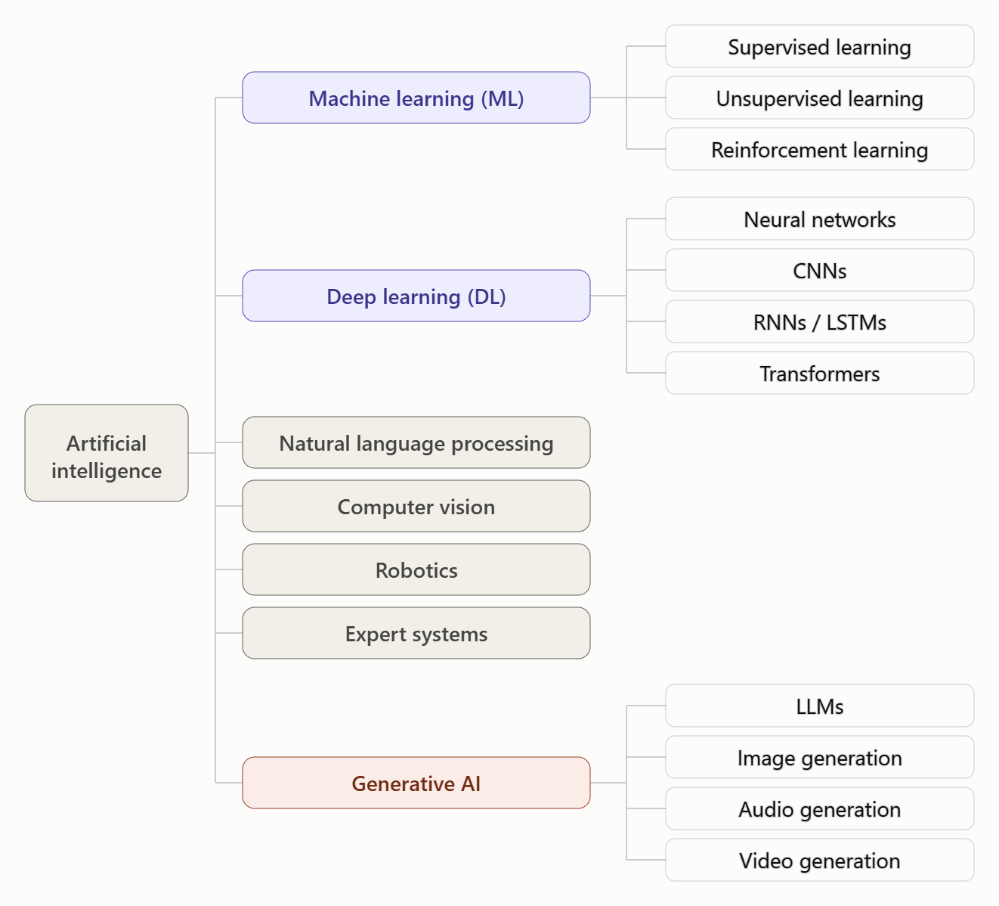

# Chapter 1 - Part 1: Artificial Intelligence

> Chapter 1: Introduction

**Artificial Intelligence (AI)** is the broad field of computer science dedicated to building machines and software capable of performing tasks that typically require human intelligence. These tasks include reasoning, learning from experience, understanding natural language, recognizing patterns, and solving complex problems.

## How AI, Machine Learning, and Deep Learning Fit Together

AI is an overarching umbrella term, with machine learning and deep learning acting as specialized subfields nested inside it.

- **Artificial Intelligence.** The widest category encompassing any technique that enables computers to mimic human intelligence, ranging from simple rule-based logic to advanced autonomous systems.
- **Machine Learning.** A subset of AI that focuses on algorithms capable of learning patterns from data and improving their performance over time without explicit programming.
- **Deep Learning.** A specialized subset of machine learning that uses multi-layered neural networks to process massive amounts of complex data like images, audio, and text.

## Categories of Artificial Intelligence

Researchers generally classify AI systems based on their capability levels and how they function.

| **AI Category** | **Description** | **Current Status** |
| --- | --- | --- |
| **Narrow AI (Weak AI)** | Systems designed and trained to perform a single specific task or a narrow set of tasks. | **Exists today.** Powers voice assistants, recommendation engines, facial recognition, and chatbots. |
| **General AI (Strong AI / AGI)** | Hypothetical machines with human-level cognitive abilities that can understand, learn, and apply intelligence across any domain. | **Theoretical.** Actively researched, though not yet achieved. |
| **Superintelligence (ASI)** | A hypothetical future form of AI that surpasses human intelligence across every field, including creativity and social reasoning. | **Purely speculative.** |

## Core Branches and Technologies of AI

Modern AI spans multiple specialized disciplines that allow machines to interact with and understand the world.

- **Natural Language Processing (NLP).** Enables computers to read, understand, translate, and generate human language, powering tools like chatbots and real-time translators.
- **Computer Vision.** Allows machines to interpret and analyze visual information from images and videos, used in medical imaging, manufacturing quality control, and autonomous vehicles.
- **Generative AI.** Focuses on creating brand-new content—including text, code, images, music, and video—by learning underlying patterns from massive training datasets.
- **Robotics and Autonomous Systems.** Combines AI software with physical hardware so machines can perceive their surroundings, navigate spaces, and perform physical tasks.

## Everyday Real-World Applications

AI operates quietly behind the scenes across nearly every modern industry.

- **Healthcare.** Assists doctors in detecting diseases early from X-rays and MRIs, accelerates drug discovery, and personalizes patient treatment plans.
- **Finance.** Detects fraudulent credit card transactions in milliseconds, automates algorithmic trading, and assesses credit risk.
- **Everyday Consumer Tools.** Powers navigation apps with real-time traffic routing, filters email spam, and curates personalized feeds on streaming and shopping platforms.

Think of AI as a large tree:

The primary goals of AI are:

- **Perception** - Understanding images, audio, and sensor data
- **Learning** - Learning patterns from data
- **Reasoning** - Drawing conclusions using knowledge
- **Decision Making** - Choosing the best action
- **Communication** - Understanding and generating language
- **Automation** - Performing tasks with minimal human intervention

## Key Takeaways

- AI is the science of making machines perform tasks requiring human intelligence.
- AI is the broadest field and acts as an umbrella covering ML, DL, NLP, Computer Vision, Robotics, and Generative AI.
- Machine Learning is a subset of AI.
- Deep Learning is a subset of Machine Learning.
- Generative AI is a subset of Deep Learning.
- Large Language Models (LLMs) are a specialized type of Generative AI focused on language understanding and generation.
