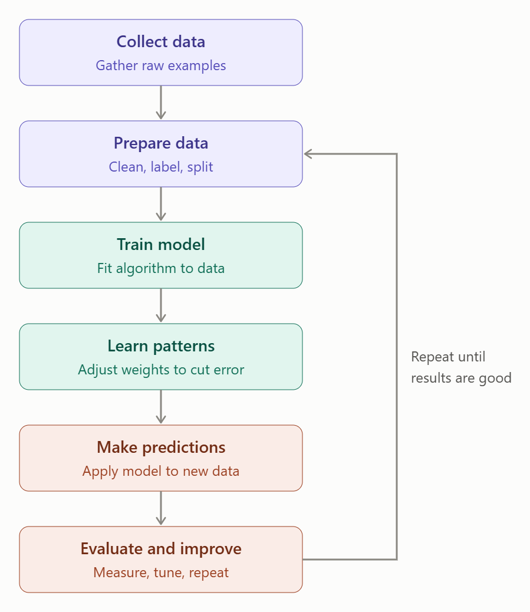

# Chapter 1 - Part 2: Machine Learning

> Chapter 1: Introduction

**Machine learning (ML)** is a branch of artificial intelligence that enables computers to learn from data and make predictions or decisions without being explicitly programmed for every task. Instead of following rigid, hard-coded rules, ML algorithms identify statistical patterns in training data and generalize those patterns to new, unseen information.

## Core Types of Machine Learning

Machine learning approaches are grouped into primary paradigms based on how models learn from data.

| **Learning Type** | **How It Works** | **Common Tasks** |
| --- | --- | --- |
| **Supervised Learning** | Trains models on labeled datasets where both input features and correct target outputs are known. | **Classification** (spam detection, medical diagnosis) and **regression** (forecasting sales or house prices). |
| **Unsupervised Learning** | Analyzes unlabeled data to discover hidden structures, relationships, or natural groupings on its own. | **Clustering** (customer segmentation), anomaly detection, and dimensionality reduction. |
| **Semi-Supervised Learning** | Combines a small amount of labeled data with a large pool of unlabeled data to improve accuracy when labeling is expensive. | Image classification, speech analysis, and web content categorization. |
| **Reinforcement Learning** | Trains an agent to make sequential decisions through trial and error within an environment. | Robotics, autonomous driving, and game-playing AI using rewards and penalties. |

## How the Machine Learning Workflow Operates

Building and deploying an effective machine learning system typically follows a structured lifecycle.

- **Data Collection and Preparation.** Raw data is gathered, cleaned to fix missing values, and formatted so algorithms can process it reliably.
- **Feature Engineering.** Domain knowledge is used to select or transform raw variables into meaningful inputs that highlight patterns for the model.
- **Model Training.** An algorithm—such as a decision tree, support vector machine, or neural network—processes the prepared data to adjust its internal parameters.
- **Evaluation and Tuning.** The trained model is tested on separate validation data to ensure it generalizes well rather than simply memorizing examples.
- **Deployment and Monitoring.** The finalized model is integrated into real-world applications and continuously tracked to prevent performance drops over time.

## Real-World Applications and Subfields

Modern ML powers everyday digital tools and serves as the foundation for specialized AI fields.

- **Deep Learning.** A specialized subset of ML that uses multi-layered artificial neural networks to process complex inputs like images, audio, and natural language.
- **Generative AI.** Models trained on massive datasets to produce original text, code, images, and video rather than just predicting labels or numbers.
- **Everyday Industry Uses.** Organizations rely on ML for personalized streaming recommendations, credit card fraud prevention, predictive maintenance, and medical diagnostics.

## Key Takeaways

- Machine Learning is fundamentally about learning patterns from data.
- Models analyze historical examples and discover hidden relationships.
- These learned patterns are used to make predictions on new data.
- The goal is generalization, not memorization.
- Better data usually leads to better pattern recognition and better predictions.
- One-Line Memory Trick

Machine Learning = Finding Patterns in Historical Data to Predict Future Outcomes.

## Classification and Prediction in Machine Learning

**Classification** and **prediction** (often referred to as **regression** in supervised learning) are the two primary tasks used to generate outputs from trained machine learning models. While prediction in a general sense describes any model output, in machine learning terminology, classification predicts a **discrete category or label**, whereas regression predicts a **continuous numerical value**.

## Key Differences: Classification vs. Regression

Both tasks fall under supervised learning, meaning models learn from labeled historical data to make decisions on new inputs.

| **Feature** | **Classification** | **Prediction (Regression)** |
| --- | --- | --- |
| **Output Type** | Discrete categories, classes, or labels (e.g., "Spam" or "Not Spam"). | Continuous numerical quantities (e.g., ₹45,00,000 or 28.5°C). |
| **Core Goal** | Find a **decision boundary** that separates data points into distinct groups. | Find a **line or curve of best fit** that estimates trends and relationships. |
| **Common Algorithms** | Logistic Regression, Decision Trees, Support Vector Machines (SVMs), Naive Bayes. | Linear Regression, Polynomial Regression, Ridge/Lasso Regression, Random Forest Regressor. |
| **Evaluation Metrics** | Accuracy, Precision, Recall, F1-Score, and ROC-AUC. | Mean Absolute Error (MAE), Mean Squared Error (MSE), and R-squared (R²). |

## Types of Classification

Depending on the problem, classification models sort data into two or more predefined buckets.

- **Binary Classification.** Assigns data into one of two mutually exclusive classes. Examples include medical tests (positive vs. negative) and credit card fraud detection (fraudulent vs. legitimate).
- **Multi-Class Classification.** Assigns each input to a single category out of three or more options. Examples include identifying handwritten digits (0–9) or classifying news articles into sports, politics, or tech.
- **Multi-Label Classification.** Assigns multiple non-exclusive tags to a single input simultaneously. An example is tagging a movie as both "Action" and "Comedy."

## How Prediction (Regression) Works

Regression models analyze how changes in input variables (features) affect a continuous target outcome.

- **Simple and Multiple Linear Regression.** Models the relationship between one or more input features and a target number using a straight line or hyperplane. A common use case is estimating house prices based on square footage, location, and number of bedrooms.
- **Time-Series Forecasting.** Predicts future numerical values based on historical data points ordered by time. Organizations use this to forecast stock prices, retail demand, or daily electricity consumption.

## Choosing Between Them

Sometimes the same business problem can be framed as either classification or regression depending on your needs.

- **Use Classification for Actionable Decisions.** If you want to know whether a customer will cancel their subscription next month ("Yes" or "No"), use binary classification.
- **Use Regression for Exact Estimates.**

If you want to estimate how many months that customer will stay subscribed or how much revenue they will generate, use regression.
