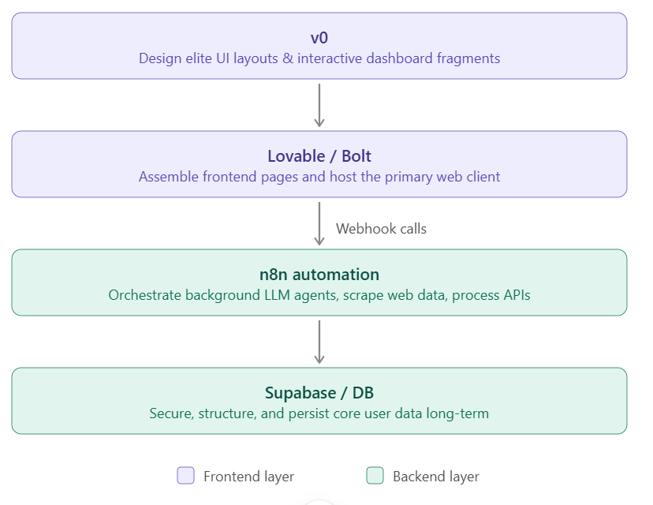

# Chapter 2 - Part 4: No-Code AI Tools: Bolt, Lovable, V0, n8n

> Chapter 2: AI Tools Landscape

The emergence of the **"Vibe Coding" paradigm has completely transformed the traditional no-code landscape.** Instead of forcing users to manually drag and drop components or wire static database fields, modern tools utilize natural language prompts to spin up fully reactive frontends, auto-provision scalable backends, and orchestrate complex background logic.

The elite tier of this no-code/low-code AI ecosystem is defined by four core platforms: **Bolt.new, Lovable, v0 by Vercel, and n8n**.

## The Direct Ecosystem Breakdown

### 1. Bolt.new (By StackBlitz): The Dev's Full-Stack Sandbox

Bolt.new functions as a complete browser-based development environment driven by WebContainers. It doesn't mock an application; it executes a real Node.js environment directly inside your browser tab.

- **How it Works:** You prompt an app idea, and Bolt spins up a framework (typically React + Vite). It dynamically searches npm, installs the required packages, writes code across a multi-file directory, and boots up a live local development server.
- **Standout Advantage:** Unrestricted access to the code. If the AI gets stuck in a loop, you can open the file tree, manually edit the JavaScript/TypeScript, and save it. It offers tight two-way sync with GitHub for external deployments.
- **The Catch:** While it natively orchestrates frontends and lightweight server setups, handling heavy backend logic or deeply secure database rules requires more intentional technical prompting.

### 2. Lovable.dev: The Ideal MVP Machine for Non-Coders

Lovable is explicitly built to take non-technical product people from a raw concept to a production-grade, database-backed web application.

- **How it Works:** Lovable heavily prioritizes design and structural polish from the very first prompt. It abstracts away the complex infrastructure by natively configuring a full-stack architecture out of the box: a sleek React frontend paired with an automated Supabase PostgreSQL backend.
- **Standout Advantage:** Out-of-the-box infrastructure. It automatically builds out user registration, secure data tables, and pre-wired payment gateways using Stripe. You can edit elements visually or chat with its unified agent.
- **The Catch:** It operates on a credit-per-message model. Large, complex feature requests can quickly exhaust your monthly credit pool if you aren't calculating your prompt workflow efficiently.

### 3. v0 by Vercel: The Elite UI Component & Page Architect

v0 is Vercel's specialized design-to-code generative system. Rather than operating as an end-to-end hosting container for complete applications, it serves as the ultimate frontend accelerator.

- **How it Works:** Optimized for the modern Vercel ecosystem, v0 accepts images, Figma snapshots, or text prompts to generate highly accessible UI layouts using Tailwind CSS and components from shadcn/ui.
- **Standout Advantage:** Design fidelity. The components generated are fully interactive, production-ready, and look mathematically clean. It is perfect for generating landing pages, custom interactive charts, and rich data tables.
- **The Catch:** It is primarily a design-forward platform. To build a real SaaS tool, you must copy the v0 components and manually wire them into a functioning backend or pair them with an orchestration platform.

### 4. n8n: The Autonomous Logic & Agent Orchestrator

Where the previous tools handle user-facing applications, n8n is the node-based workflow automation platform that serves as the invisible background brain.

- **How it Works:** n8n lets you design complex linear or branching data chains. With its native Advanced AI nodes, you can drop foundational LLMs directly into the canvas, transforming a basic automation chain into an active, tool-using AI Agent workflow.
- **Standout Advantage:** Enterprise-grade extensibility. You can capture an input form from Lovable or Bolt via an n8n webhook, run advanced text extraction, search the web via specialized APIs, check a local SQL database, and push the processed result straight back to the frontend UI.
- **The Catch:** It requires a solid grasp of structural web concepts, including formatting JSON payloads, managing webhooks, and interacting with REST APIs.

## Direct Feature Comparison Matrix

| Feature | Bolt.new | Lovable.dev | v0 by Vercel | n8n |
| --- | --- | --- | --- | --- |
| Primary Focus | Full-Stack Browser Dev Environment | Rapid MVP & SaaS Production | Elite UI Component Architecture | AI Agent Workflows & Backend Logic |
| Frontend Stack | Framework flexible (React/Vite default) | React / TypeScript / Tailwind | Next.js / Tailwind / shadcn/ui | Custom node-based visual UI dashboards |
| Backend / DB | Node.js/Express, optional edge DBs | Native Supabase PostgreSQL | Next.js API Routes / Vercel DBs | Visual Node integrations (SQL, NoSQL, Vector) |
| Target User | Technical founders & developers | Non-technical founders & PMs | Product Designers & Frontend Engineers | Automation Architects & Ops Engineers |
| Code Control | High (Direct inline terminal & file editing) | Medium (Visual edits + strict GitHub export) | Medium (Copy-paste code blocks / Vercel deploy) | Low-to-Medium (Custom JavaScript/Python code blocks) |

## The Ultimate No-Code Stack Power-Up

To unlock true architectural freedom, avoid treating these platforms as isolated silos. Combining them creates a comprehensive application factory. The most common engineering design pattern for a no-code MVP utilizes this decoupled architecture:

