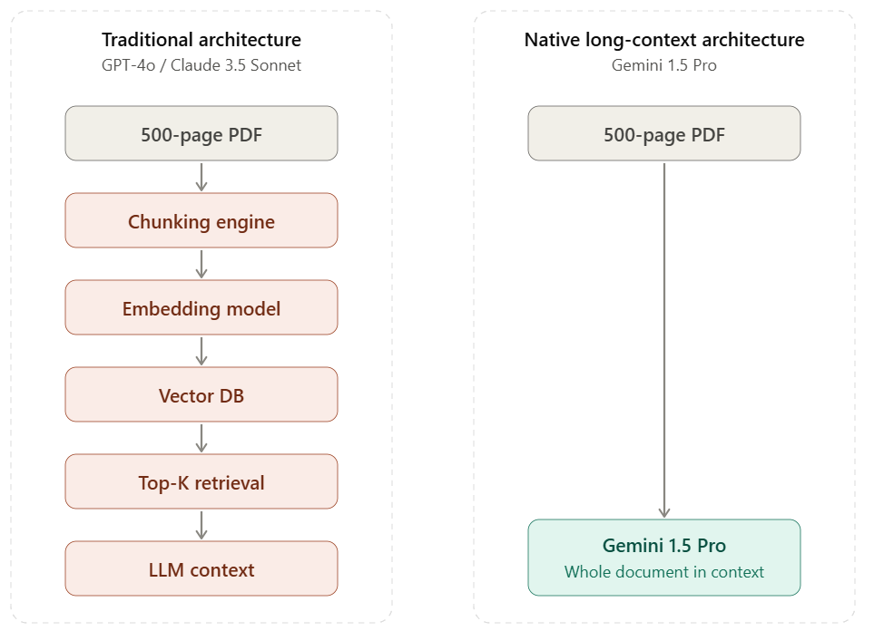
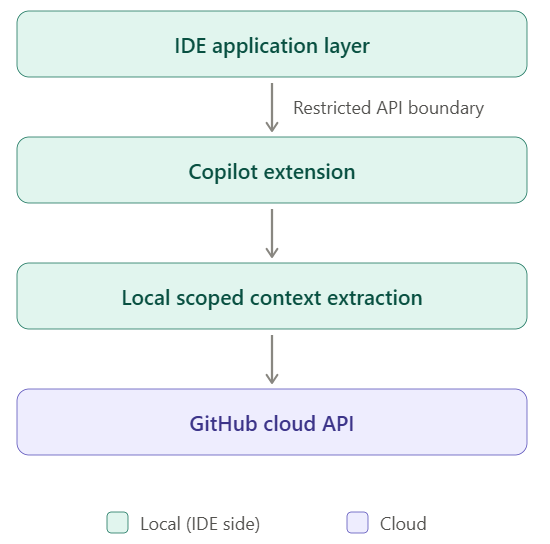
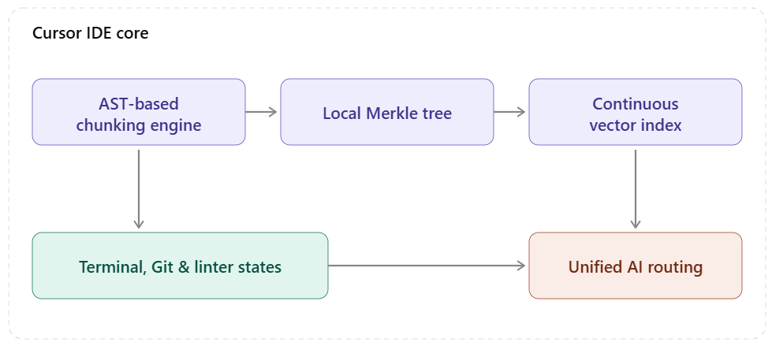

# Chapter 2 - Quick Check

> Chapter 2: AI Tools Landscape

> Related part: No-Code AI Tools: Bolt, Lovable, V0, n8n

### Q1. GPT-4o has a 128K token context window. Claude 3.5 Sonnet has 200K. Gemini 1.5 Pro has 1M. If you need to process a 500-page legal document in a single call, which model is the only viable option? Why does this matter architecturally?

**Google Gemini 1.5 Pro is the only viable option** for processing a 500-page document in a single call.

A standard 500-page legal document contains roughly 250,000 words, which translates to approximately **330,000 to 350,000 tokens**. Because GPT-4o (128K) and Claude 3.5 Sonnet (200K) fall well below this threshold, their context windows would overflow, resulting in severely truncated data. Gemini 1.5 Pro’s 1-million (and now natively scaling up to 2-million) token window handles this payload with massive headroom.

**Architectural Implications: Why This Matters**

Shifting from a 128K/200K window to a 1M+ window changes your entire infrastructure from a complex data-engineering puzzle into a direct ingest pipeline.

**1. The Death of the Fragile RAG Pipeline**

In standard architectures, you cannot pass a massive document directly. You are forced to build a **Retrieval-Augmented Generation (RAG)** pipeline: chunking the text into fragments, converting them into vector embeddings, storing them in a database, and pulling the top 5–10 "most relevant" snippets.

- **The Fragility:** If a legal clause on page 420 relies on a definition stated on page 12, a standard RAG system frequently fails to connect them because it only looks at isolated snippets.
- **The Long-Context Fix:** Gemini allows you to drop the entire unstructured contract directly into the prompt. The model retains full global awareness of cross-references, systemic definitions, and non-linear logic.

**2. Elimination of Pre-Processing Information Loss**

Every step in a traditional data pipeline introduces loss. Text extraction tools mangle tables, chunking algorithms slice sentences in half, and embedding models lose semantic nuance. By feeding the document whole, you eliminate the engineering overhead of building, tuning, and maintaining chunking strategies.

**3. The "Needle in a Haystack" and Attention Risk**

While huge context windows sound ideal, they present a massive architectural challenge known as the **"Lost in the Middle"** phenomenon. Early long-context models were excellent at reading information at the very beginning or the very end of a prompt, but frequently overlooked details buried deep in the middle.

Gemini’s architecture uses advanced attention mechanisms to achieve near-perfect "Needle in a Haystack" retrieval across its entire window. However, architecturally, this comes with two massive trade-offs:

- **Latency:** Processing 350,000 tokens in a single turn forces the model to calculate relationships across a massive matrix. Your Time-to-First-Token (TTFT) will scale from milliseconds to many seconds.
- **Compounding Cost:** Standard LLM pricing charges you per input token *on every single turn*. If you are having a multi-turn conversation about that 500-page document, you are re-sending and re-paying for those 350,000 tokens with every follow-up question unless the platform utilizes aggressive context caching.

### Q2. Look at the API Structure Note at the bottom of Demo 4. What is the difference in how OpenAI and Anthropic structure their response objects? Why does this matter if you are building a system that needs to call both providers? (You will write the actual extraction code in Class 18 - for now, just note the field name difference and think through the implication.)

Based on the code snippet provided, here are the direct structural differences between the two providers and their architectural implications for multi-model systems.

#### 1. Structural Differences in Response Objects

OpenAI and Anthropic structure both their textual payload outputs and their token metadata metrics using entirely different JSON naming conventions:

| Feature | OpenAI API Shape | Anthropic API Shape |
| --- | --- | --- |
| Text Content Path | response.choices[0].message.content | response.content[0].text |
| Input Tokens Key | response.usage.prompt_tokens | response.usage.input_tokens |
| Output Tokens Key | response.usage.completion_tokens | response.usage.output_tokens |

- **OpenAI** groups text outputs inside a choice array to account for legacy configurations that supported generating multiple chat variations simultaneously, and uses traditional database/NLP terminology (prompt/completion) for token logging.
- **Anthropic** uses a content block architecture optimized for multi-modal flexibility (handling images, text, and tool blocks in sequence), and applies explicit direction-based terms (input/output) to its token tracking.

#### 2. Why This Matters for Multi-Provider Systems

If you are writing raw code to switch dynamically between OpenAI and Anthropic, these differences will create critical engineering bottlenecks:

- **Immediate Runtime Failures:** A single utility function attempting to parse response.choices[0] will immediately crash with a KeyError or AttributeError the moment it receives an Anthropic response payload.
- **Broken Financial & Telemetry Logs:** If you are tracking API costs or monitoring throughput across your system, a uniform tracking script will fail to register token consumption because the keys do not align. Failing to pull input_tokens or completion_tokens properly will completely blind your application's analytics dashboards.
- **High Code Maintenance (Coupling):** Forcing your core business logic to know exactly which provider is being called means every time you want to switch or try a new model, you have to write messy if/else conditional routing blocks across your entire codebase.

### Q3. What is the difference between GitHub Copilot and Cursor at the architecture level - not the interface level? What specific problem does Cursor's approach solve that Copilot's does not?

At the architectural level, the difference between GitHub Copilot and Cursor is defined by a Plugin/Extension Architecture versus an OS/IDE-Native Integration Architecture.

While both tools ultimately call powerful large language models (like Claude or GPT variants) under the hood, the way they extract, index, and funnel your code into those models is fundamentally different.

1. **The Architectural Breakdown**

### GitHub Copilot: The Sandbox Plugin Extension

GitHub Copilot is architected as an **Application Extension**. It runs inside a restricted sandbox environment provided by the IDE host's API (whether it is VS Code, JetBrains, or Neovim).

**Context Scoping:** Copilot relies primarily on the IDE's standard extension APIs to scrape text. It looks at your **active tab** and a limited heuristic window of recently visited or neighboring open files.

**State Control:** Because it is a guest inside the editor, it cannot natively hijack the IDE’s terminal lifecycle, internal compiler states, or file-writing systems without going through the IDE’s constrained extension interface layers.

### Cursor: The AI-First Forked IDE Architecture

Cursor is an **AI-Native Forked Core**. The team literally took the open-source core of Visual Studio Code (VSCodium), threw out the standard extension barriers, and tightly coupled the IDE's internal systems directly to an AI orchestration engine.

- **Continuous Semantic Indexing (Local-to-Cloud Pipeline):** Cursor runs a continuous background data pipeline directly over your entire repository. It parses files locally using an Abstract Syntax Tree (AST) chunking engine, builds a local hierarchical **Merkle Tree** to instantly track file state changes (diffs), hashes the modified code, and syncs vector embeddings to a lightning-fast semantic search index.
- **Deep State Coupling:** Because it *is* the editor, the AI engine has zero abstraction lag. It directly intercepts linter errors, monitors the active terminal buffer outputs, and controls the workspace filesystem.
- **Proprietary Multi-File Prediction Model:** Cursor routes standard tab autocompletions through a custom, highly optimized, hyper-fast proprietary model that isn't just predicting the next word in one file, but is continuously listening to cross-file imports and dependency graphs.

#### 2. The Specific Problem Cursor Solves (That Copilot Fails At)

Cursor's architecture directly solves **The Cross-File Dependency & Broken Context-Window Problem**.

### The Problem:

When you perform major refactoring or build features in modern software, code changes are rarely isolated to a single file. Adding a property to a database schema requires modifying the backend API endpoint, rewriting the frontend query fetch loop, and updating three different unit test suites.

### How GitHub Copilot Handles It:

Because Copilot is functionally blind to files that aren't open in your editor tabs or immediately adjacent in the file tree, it suffers from severe "context fragmentation". If you ask Copilot to change a backend structure, it cannot accurately guess how your frontend uses it unless you manually open those specific frontend tabs to force them into the extension's transient context memory window.

### How Cursor's Architecture Solves It (via Composer Mode):

Cursor's background Merkle/Vector indexing pipeline turns your entire workspace into a globally queryable graph database.

When you use its multi-file agentic engine (**Composer mode**), the architecture executes a multi-step loop:

1. The AI agent analyzes your prompt and queries its **semantic vector index** to map out the exact files that will be touched by the dependency chain.
2. It simultaneously injects the project's **active compiler/linter state** and **terminal logs** into the model's context window.
3. Instead of generating a single isolated chunk of code text, it streams a **unified git diff block** targeting 5, 10, or 20 distinct local file paths simultaneously.
4. It creates, deletes, or alters files on disk autonomously, then checks the editor's live linter to see if its edits broke any TypeScript compilation rules, self-correcting the code before presenting the final changes to you.

**The Bottom Line:** GitHub Copilot acts as a faster pen that auto-completes syntax within your line-of-sight. Cursor acts as a full-fledged structural engineering assistant with a live blueprint map of your entire system.

Are you exploring these tools for a specific project? Let me know:

- The **approximate scale of your codebase** (small prototype vs. massive distributed microservices)
- Your team's **corporate compliance or data privacy requirements** (e.g., if you require strict self-hosting or enterprise IP indemnity)

### Q4. A teammate says "just use ChatGPT, it's the best." What three questions would you ask to determine if that is actually the right choice for their use case?

To determine if ChatGPT is truly the right tool for your teammate's specific task, you need to evaluate the nature of their data, the required output accuracy, and how the tool will be integrated into their workflow.

Here are the three questions you should ask:

- "What kind of data are you inputting, and are there privacy or compliance restrictions?" Why it matters: If the task involves proprietary source code, protected health information (PHI), or strictly confidential client data, pasting it into a public LLM may violate corporate data privacy policies or compliance regulations (like GDPR or HIPAA).
- "Does the task require absolute factual accuracy, or is it purely creative and collaborative?" Why it matters: Large language models are prone to "hallucinations" (generating plausible-sounding but false information). If the use case requires precise legal citations, complex mathematical calculations, or verified historical facts without human auditing, ChatGPT alone might be risky compared to dedicated software or deterministic tools.
- "Are you looking for a quick, one-off brainstorm, or do you need a highly structured, repeatable workflow?" Why it matters: ChatGPT excels at interactive, conversational problem-solving, text summarization, and drafting. However, if the goal is to process thousands of standardized data rows daily or integrate automation directly into an existing software pipeline, a specialized API, an ETL tool, or traditional automation scripting might be far more efficient.

### Q5. V0 and Bolt both generate code. What is the functional difference between them? In what situation would you use one over the other?

While both platforms generate web applications using AI, v0 (by Vercel) focuses on production-grade UI refinement and deep ecosystem integration, whereas Bolt (by StackBlitz) focuses on instant, browser-native full-stack prototyping.

The primary difference lies in their underlying environments and how they treat the development lifecycle.

| Capability | v0 (Vercel) | Bolt (StackBlitz) |
| --- | --- | --- |
| Primary Strength | Highly polished UI components, pixel-perfect layouts, and enterprise design adherence. | Complete, runnable project scaffolds with integrated frontend, backend, and package management. |
| Tech Stack | Specialized for **React, Next.js, Tailwind CSS**, and **shadcn/ui**. | Highly flexible; supports **Vue, Svelte, Angular, Astro**, and mobile setups (via Expo). |
| Runtime & IDE | Runs inside a cloud VM. Edits happen inside chat or Design Mode, moving code natively through **GitHub pull requests**. | Runs a local Node environment in your browser using **WebContainers**. Includes a full interactive code editor and a live terminal. |
| Code Intent | Written for developers to immediately **copy, inspect, and paste** into an established local codebase. | Built for rapid iteration, installing npm packages on the fly to get a **complete application working out of the box**. |
| Hosting & Deploy | Deploys natively to **Vercel** production and preview URLs. | Deploys instantly to **bolt.host** or Netlify directly from the browser. |

### When to Use Which?

*Use v0 if:*

You are an engineer working on a production app: You already have a Next.js or React application setup and need to build a complex dashboard layout, a beautiful checkout page, or custom components that you will manually maintain.

Design fidelity is paramount: You need your interface to look stunning right from the start to impress clients, executives, or investors.

You work in a team setting: You want a clean Git-driven workflow where AI changes are requested, reviewed, and approved via pull requests rather than overwriting files directly.

*Use Bolt if:*

You want a quick, working full-stack MVP: You are starting from absolute scratch and want a functional web app—complete with simulated databases, authentication UI, and active package installations—in under 10 minutes.

You aren’t using Next.js / React: You prefer building with Vue, Svelte, or need to quickly test an idea in a completely different modern framework.

You are non-technical or solo-hacking: You don't want to deal with terminal errors, setting up a repository, or managing environment configurations just to get a basic working prototype off the ground.

### Q6. You run Demo 4 and notice that Claude's three-sentence explanation of transformers uses different terminology than GPT-4o's. What does this tell you about how you should approach prompt design if your output needs to be consistent regardless of which model you use?

This divergence in terminology tells you that different foundational models rely on different internal token weights, training data biases, and default personas. If left unguided, Claude and GPT-4o will naturally drift toward their own distinct vocabularies (e.g., Claude leans more academic and detailed, while GPT-4o defaults to conversational or direct summaries).

To enforce absolute consistency across models, you must transition from open-ended prompting to declarative, constrained architecture.

Approach your cross-model prompt design using these core shifts:

#### 1. Hardcode Your Vocabulary (Lexicon Constraints)

Never let the model choose its own industry terms. If specific terminology is required, explicitly define it inside the prompt.

Vague Prompt: "Explain transformers in three sentences."

Cross-Model Consistent Prompt: "Explain transformers in three sentences. You must exclusively use the terms 'Self-Attention mechanism', 'Token embeddings', and 'Positional encoding'. Do not use the phrases 'neural network sequence' or 'context window'."

#### 2. Anchor with Few-Shot Examples

Providing 2–3 exact output templates is the single most effective way to eliminate model-specific stylistic drift. When you provide a "gold standard" example, both Claude and GPT-4o will suppress their default vocabulary and mimic the syntactic structure, vocabulary density, and tone of your sample.

#### 3. Implement Strict Structural Delimiters

Use explicit, universal Markdown elements or XML tags (such as <output_structure> or ### Summary). Forcing models to write into a rigorous framework strips away their default structural preferences (like Claude's tendency to include conversational preambles or GPT's reliance on bulleted lists).

#### 4. Clamp the Temperature Parameters

Consistency is not just about prompt text; it is about API execution. You must set the temperature to 0 or 0.1 in your deployment configuration. A lower temperature forces both models to select the most mathematically predictable tokens, significantly narrowing the stylistic gap between them.

### Q7. n8n is described as an automation tool with LLM integration. What is the difference between a standard n8n workflow node and an AI Agent node in n8n? What does the AI Agent node enable that a standard LLM call node cannot do on its own?

The fundamental distinction between these nodes comes down to deterministic rules versus autonomous execution loops.

A Standard n8n Node follows a rigid, predictable pattern: it always processes data sequentially, executing exactly what is configured every single time (e.g., pulling data from an API, applying code, and pushing it to a spreadsheet). In contrast, an n8n AI Agent Node acts as a root controller that wraps an LLM in a continuous, goal-oriented reasoning loop. Instead of following hardcoded steps, it evaluates an ambiguous request, decides which connected tools it needs, analyzes the intermediate results, and stops only when the goal is met.

### The Anatomy: Standard Node vs. AI Agent Node

To highlight how they handle logic, costs, and flexibility, look at their architectural differences:

| Feature | Standard n8n Workflow Node | n8n AI Agent Node |
| --- | --- | --- |
| Logic Type | **Deterministic & Linear**; follows predefined visual paths exactly. | **Agentic & Iterative**; figures out its own paths dynamically. |
| Cost & Latency | Low and predictable; executes in a single pass. | High and variable; charges per-token across multiple reasoning loops. |
| Inputs Handled | Structured data with strict schema mappings. | Unstructured, flexible, and ambiguous natural language queries. |
| Canvas Topology | Single, independent box wired strictly into a left-to-right flow. | A root cluster socketed underneath to sub-nodes for Models, Memory, and Tools. |

What the AI Agent Node Enables (Over a Standard LLM Call Node)

While a standard "Basic LLM Chain" node allows you to send a prompt and get text back (a single-shot action), it is static. The AI Agent node unlocks multi-step autonomy via three specialized features:

#### 1. Dynamic, Non-Linear Tool Selection

A standard LLM node can only generate a message saying "I need to check your calendar." The AI Agent node can actually go out and do it. By exposing n8n nodes (like Gmail, HubSpot, or custom HTTP requests) as "Tools" underneath the Agent, the LLM reads the tool descriptions, decides which ones are relevant, and triggers them on the fly.

#### 2. Multi-Step Execution Loops (Self-Correction)

If a user prompt requires data from multiple sources, a standard LLM call fails because it can only generate one response. The AI Agent node operates in a Reasoning-Action-Observation loop: Step 1: "To answer this, I need to fetch the user's order history using the database tool."

- Step 2: It reads the database tool's output.
- Step 3: "Now that I have the tracking number, I will call the shipping API tool to find the package location."
- Step 4: It aggregates those pieces into one coherent final response.

#### 3. Native Memory Management

Standard LLM nodes are completely stateless; they treat every workflow execution as an isolated event. The AI Agent node anchors context by connecting to memory sub-nodes (like Redis, Postgres, or window buffers). This allows the agent to recognize conversation continuity across multiple separate executions (e.g., knowing what "it" refers to based on a message sent five minutes prior).
