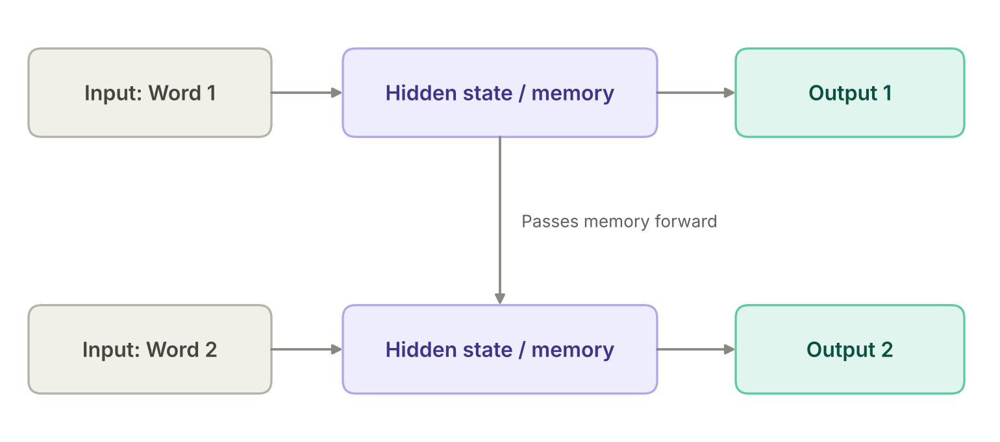

# Chapter 3 - Part 2: NLP history: word2vec → RNN/LSTM → the sequential bottleneck that broke everything

> Chapter 3: What is an LLM? + Transformers and How They Work

The history of **Natural Language Processing (NLP)** spans over seven decades, evolving from a branch of computer science focused on strict mathematical logic into the fluid, generative artificial intelligence we use today.

Here is the comprehensive timeline of how machines learned to read, speak, and write.

## Era 1: The Foundations & Symbolic AI (1950s – 1980s)

Early NLP relied entirely on **linguistic rules** written by hand. Scientists believed that if they could map out the complete blueprint of grammar and dictionaries, a computer could think logically like a human.

- **1950 — The Turing Test:** Alan Turing published Computing Machinery and Intelligence, introducing the "Imitation Game" (Turing Test) as a benchmark for machine intelligence.
- **1954 — The Georgetown Experiment:** The first public showcase of machine translation. A computer successfully translated 60 Russian sentences into English using a tiny dictionary and a strict set of rule-based logical steps.
- **1966 — The ALPAC Report:** A US government committee concluded that machine translation was more expensive, less accurate, and slower than human translation. This pulled the plug on funding and triggered the first "**AI Winter**."
- **1966 — ELIZA:** Developed at MIT, ELIZA was the world’s first chatbot. It simulated a psychotherapist by using simple phrase-matching tricks (e.g., if the user wrote "My mother...", it replied "Tell me more about your family").

## Era 2: The Statistical Shift (1990s – 2000s)

Instead of forcing computers to learn language rules, researchers started giving them text databases (corpora) and using **probability** to let them guess word patterns.

- **1990s — The Rise of Corpora:** The sudden availability of large text data (like the Wall Street Journal archives) allowed computers to calculate data trends mathematically.
- **Part-of-Speech Tagging:** Rather than hand-coding grammar, algorithms used Hidden Markov Models (HMMs) to look at a text database and calculate the odds that a specific word acted as a noun, verb, or adjective based on its surrounding context.
- **Statistical Machine Translation (SMT):** IBM developed models that mapped translations by calculating word-pairing frequencies between languages. This statistical foundation later powered the original release of Google Translate (2006).

## Era 3: The Early Deep Learning Wave (2010s – 2016)

The explosion of computational power allowed researchers to throw out basic counting statistics and replace them with **Artificial Neural Networks** that represented language geometrically.

- **2013 — Word2Vec:** Google released a technique that turned words into spatial vectors (embeddings). For the first time, mathematical distance represented semantic meaning. It famously proved it could solve word analogies through vector math:

$$
\text{Vector}\left( “\text{King}” \right) - \text{Vector}\left( “\text{Man}” \right) + \text{Vector}\left( “\text{Woman}” \right) = \text{Vector}\left( “\text{Queen}” \right)
$$

- **2014 — Sequence-to-Sequence (Seq2Seq):** Introduced by Ilya Sutskever and others, this architecture allowed neural networks to convert an entire sequence of input words (like a French sentence) into a different sequence of output words (like an English sentence).
- **RNNs and LSTMs:** Recurrent Neural Networks and Long Short-Term Memory networks became the dominant architecture. They read sentences sequentially, word-by-word from left to right, maintaining an internal memory to track context.

## Era 4: The Transformer & Modern LLMs (2017 – Present)

The sequential nature of older networks meant they struggled to process massive blocks of data or remember far-away context. A single paradigm shift fixed both flaws, paving the way for modern AI.

- **2017 — "Attention Is All You Need":** Google researchers published a landmark paper introducing the Transformer architecture. By replacing sequential processing with a **Self-Attention mechanism**, the model could read all words in a document simultaneously, map their complex relationships instantly, and leverage massive amounts of modern hardware parallelization.
- **2018 — BERT:** Google introduced Bidirectional Encoder Representations from Transformers, which read sentences in both directions at once. It set new accuracy records for text search, sentiment analysis, and question answering.
- **2018–2020 — The GPT Boom:** OpenAI pioneered the decoder-only approach with Generative Pre-trained Transformers (GPT-1, GPT-2, and GPT-3), proving that scaling model size and training data led to emergent generation abilities.
- **2022 — The Consumer AI Revolution:** OpenAI launched ChatGPT, demonstrating that reinforcing an LLM with human conversational feedback (RLHF) created a highly versatile consumer assistant, sparking the global generative AI wave.

## Summary Matrix: The Evolution of NLP

| Era | Core Approach | Data Scale | Main Limitation |
| --- | --- | --- | --- |
| Symbolic (50s–80s) | Hand-written grammar rules | Tiny vocabularies | Fragile; could not handle ambiguous or conversational words. |
| Statistical (90s–00s) | Counting word frequencies & odds | Small text books | No concept of true word meaning or long sentences. |
| Early Deep Learning (2010–16) | Reading word-by-word with RNNs | Large digital libraries | Forgot structural context by the end of long paragraphs. |
| Modern LLM (2017–Pres.) | Massively parallel Transformers | The entire public internet | Highly intensive compute requirements and risk of hallucination. |

## RNN/ LSTM

A Recurrent Neural Network (RNN) is a class *of artificial neural network designed specifically to process sequential data, such as text, audio, time-series, or stock market data*.

Unlike traditional feedforward neural networks that process every input independently, RNNs possess an internal memory loop. This loop allows the network to pass information from one step of a sequence to the next, making them ideal for tasks where context matters.

### The Core Concept: Memory Through Time

To understand an RNN, think of how you read this sentence. You don't look at each word as an isolated object; you understand each word based on your memory of the words that came before it.

Traditional neural networks can't do this. They treat every input like a fresh slate. An RNN fixes this by feeding its previous output back into itself as an input for the next step.

### The Math Analogy

If a standard neural network is a formula like:

$$
\text{Output} = f\left( \text{Current Input} \right)
$$

An RNN adds a dependency on its own history:

$$
\text{Output} = f\left( \text{Current Input} + \text{Previous Memory} \right)
$$

### The Great Flaw: Why Standard RNNs Broke Down

While the idea of a memory loop sounds perfect, standard RNNs suffered from a critical mathematical vulnerability known as the **Vanishing Gradient Problem**.

When training a neural network, the model calculates errors and sends updates backward through the network to learn. Because an RNN processes data step-by-step through time, the error signal has to travel back through every single time step.

- **The Vanishing Gradient:** If the network is long (like a paragraph of 50 words), the math requires multiplying numbers together repeatedly. If those numbers are small fractions (e.g., 0.5), multiplying them over and over makes them shrink toward zero (0.5 × 0.5 × 0.5…).
- **The Consequence:** The network completely "forgets" the beginning of a sequence. If it reads a long paragraph starting with "*I grew up in France..."* and finishes with "*Therefore, I speak fluent _____,*" the error signal vanishes before it can link the blank space back to the word "France".

### The Fix: LSTM (Long Short-Term Memory)

To fix this short-term memory loss, researchers Hochreiter and Schmidhuber created the **LSTM** in 1997. LSTMs are a specialized, upgraded version of RNNs that introduced a "**Cell State**"—a corporate conveyor belt running straight through the entire sequence.

Instead of passing the whole memory through a messy loop, an LSTM uses structural "**Gates**" to manage information:

- **Forget Gate:** Decides what useless information from the past to throw away.
- **Input Gate:** Decides what new information from the current step is worth keeping.
- **Output Gate:** Decides what the next visible memory step should be.

This conveyor belt allowed the mathematical signal to stay intact, meaning LSTMs could successfully bridge gaps of over 100 words.

### RNNs vs. Transformers (The Modern Era)

From 2013 to 2017, LSTMs and RNNs ruled the NLP world. However, they were eventually replaced by the **Transformer architecture** that powers today's LLMs due to a fundamental structural limitation:

| Feature | RNNs / LSTMs | Transformers (Modern LLMs) |
| --- | --- | --- |
| Processing Style | **Sequential** (Word-by-word) | **Parallel** (All words at once) |
| GPU Optimization | Poor. Hardware must wait for Word 1 to finish before starting Word 2. | Excellent. Modern GPUs can crunch massive blocks of data simultaneously. |
| Memory Limit | High, but degrades over very long paragraphs. | Infinite mathematical range (bounded only by computational memory). |
