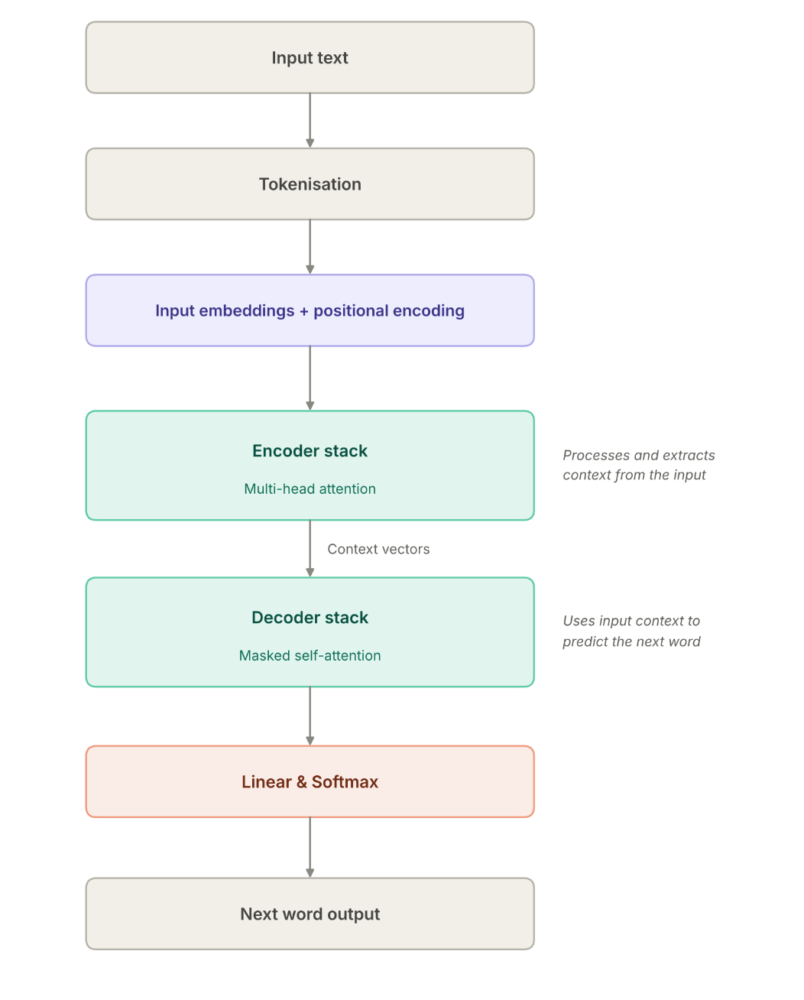
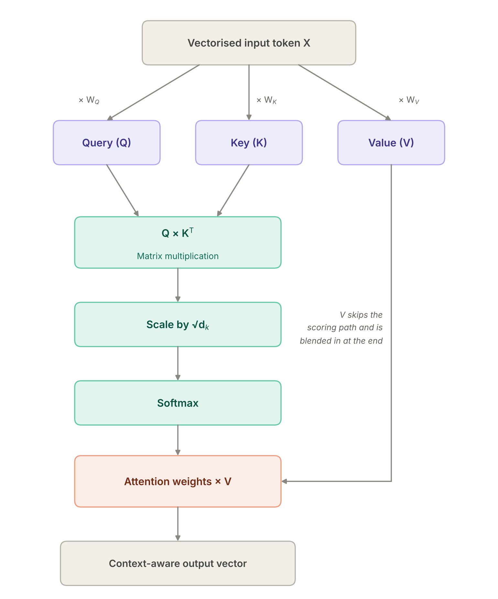
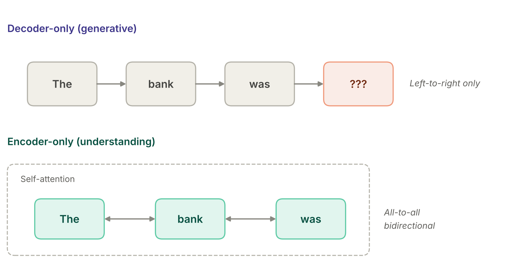
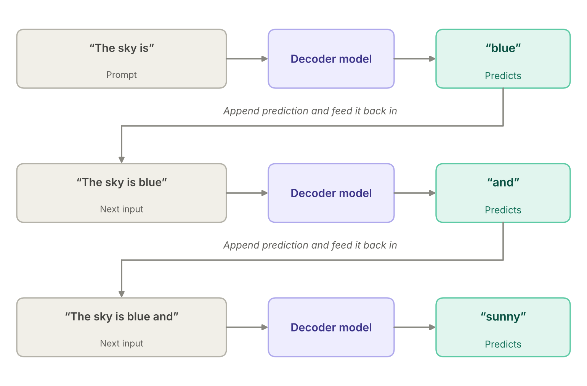

# Chapter 3 - Part 4: Transformer architecture: self-attention mechanics, encoder-only vs decoder-only

> Chapter 3: What is an LLM? + Transformers and How They Work

The **Transformer architecture** is the structural blueprint introduced by Vaswani et al. in 2017. Unlike older neural networks that processed language like a conveyor belt (word-by-word), the Transformer acts like a digital lens that looks at an entire document all at once, calculating the relationship between every single word simultaneously.

The original architecture consists of two main halves: the **Encoder** (which reads and understands text) and the **Decoder** (which generates text). While modern LLMs like GPT or Claude typically use only the Decoder portion, understanding the full original framework explains how modern generative AI operates.

**The Global Architecture: Step-by-Step**

Here is exactly how data flows through a Transformer from the moment you hit enter on a prompt to the moment the model generates a response.

## Inside the Components: The Mechanics

### 1. The Prep Phase: Embeddings & Positional Encoding

Because neural networks only understand math, text must be converted into numerical matrices before entering the model.

- **Input Embeddings:** Words are split into chunks (tokens) and mapped into a high-dimensional vector space. Words with similar meanings sit closer together geometrically.
- **Positional Encoding:** Because the Transformer processes all words simultaneously, it has no native concept of word order. The architecture solves this by adding a mathematical wave signal (sine and cosine waves) directly to the word vectors. This acts as a digital time stamp, giving the model a precise map of each word’s position in a sentence.

### 2. The Encoder Stack (Contextual Analysis)

The Encoder’s job is to take the input sequence and build a dense, multi-layered map of what the text actually means.

- **Multi-Head Self-Attention:** This is the core engine. It allows every word in the prompt to look at every other word to deduce its current contextual meaning. By using multiple "heads," the network can track syntax, pronoun references, and conceptual definitions simultaneously.
- **Feed-Forward Neural Network:** Once attention maps the connections, this standard neural layer processes each word vector individually to refine its features.
- **Residual Connections & Layer Normalisation:** These are structural architectural safeguards. They act as shortcuts that allow information to flow smoothly across deep layers without degrading, preventing mathematical errors during model training.

### 3. The Decoder Stack (Fluid Text Generation)

The Decoder's job is to take the conceptual map created by the Encoder and use it to predict the next word in the sequence, one token at a time.

- **Masked Multi-Head Attention:** When generating text, the model is not allowed to cheat by looking ahead at words it hasn't written yet. This layer "masks" (hides) future tokens during training, forcing the model to guess the next word based only on the words that came before it.
- **Encoder-Decoder Attention:** This layer acts as a bridge. It allows the generation engine in the Decoder to look back at the original conceptual map produced by the Encoder, ensuring the generated answer matches the user's initial prompt.

### 4. The Output Phase: Linear & Softmax

Once the Decoder finishes its calculations, it passes the data to a final processing layer to turn math back into a word.

- **Linear Layer:** A standard neural layer that projects the Decoder's output back into a massive array representing every single word in the model's vocabulary (often 32,000 to 100,000+ words).
- **Softmax Layer:** Converts those raw array numbers into concrete percentages. If the vocabulary word "mat" receives a 92% probability score and "refrigerator" receives a 0.01% score, the system selects "mat" as the next word.

## The Modern Shift: Encoder-Only vs. Decoder-Only

While the 2017 paper designed this dual Encoder-Decoder setup for machine translation, the AI industry quickly realized you could split the architecture apart depending on the task:

| Architecture Type | What It Uses | Primary Purpose | Real-World Examples |
| --- | --- | --- | --- |
| Encoder-Only | Only the reading half | **Understanding:** Classification, search optimization, sentiment tracking | Google BERT |
| Decoder-Only | Only the writing half | **Generative AI:** Auto-regressive text completion, chat assistants, code generation | OpenAI GPT, Meta Llama |
| Encoder-Decoder | Both halves intact | **Sequence Translation:** Translating languages, turning audio transcripts into text | Google T5, OpenAI Whisper |

## Self-Attention Mechanics

To truly understand **Self-Attention mechanics**, you have to step away from the abstract metaphors and look at the exact linear algebra that happens inside a Transformer layer.

The core mission of **Self-Attention** is simple: take a list of isolated word vectors and transform them into context-aware vectors by letting every word mathematically interact with every other word.

Here is the exact mechanical breakdown of how a raw input becomes an attention-weighted output.

### The Operational Architecture

Before the math starts, the model initializes three distinct weight matrices during training: **W****Q****(Query)**, **W****K****(Key)**, and  **W****V****(Value)**. These matrices act as trainable linear projections that convert raw tokens into specific functional representations.

### The 4-Step Mathematical Process

Let's track this process using a simple example sentence: "**The bank was muddy.**" We will isolate the word "**bank**" (×bank) and see how it calculates its attention context.

### Step 1: Projecting Q, K, and V

The raw embedding vector for "bank" (×bank) is multiplied by the three trained weight matrices to create three new vectors:

- **Query (***Q**bank***):** What is this word looking for? (e.g., "*I am an ambiguous noun, looking for surrounding context words that explain my setting.*")
- **Key (***K**bank*): What kind of identity or context does this word offer to others?
- **Value (***V**bank***):** The actual semantic information or content of the word that will be passed forward if matched.

(Every other word in the sentence—"*The*", "*was*", "*muddy*"—simultaneously generates its own Q, K, and V vectors.)

### Step 2: Calculating the Raw Match Score (Dot Product)

To find out how much "*bank*" should care about every other word, the model takes the **Query vector of "***bank***"** and calculates the **dot product** against the **Key vectors** of all words in the sentence.

$$
\text{Raw Score} = {Q}_{\text{bank}} \cdot {K}_{\text{word}}
$$

The dot product is a geometric measurement of alignment. If two vectors point in similar directions in high-dimensional space, the dot product yields a massive positive number.

- ${Q}_{\text{bank}} \cdot {K}_{\text{the}} \to$**Low score**
- ${Q}_{\text{bank}} \cdot {K}_{\text{was}} \to$**Low score**
- ${Q}_{\text{bank}} \cdot {K}_{\text{muddy}} \to$**High score** (because “muddy” provides the exact environmental context the query wanted).

### Step 3: Scaling and Softmax (Normalisation)

If the raw dot product scores get too large, they can cause the neural network's gradients to destabilize during training. The authors solved this with two steps:

1. **Scaling:** Divide the raw scores by the square root of the dimension of the key vectors $(\sqrt{{d}_{k}})$
2. **Softmax:** Pass the scaled scores through a Softmax function. This squashes all the raw numbers into a clean probability distribution between 0 and 1, where all numbers add up to exactly 100%.

$$
\text{Attention Weights} = \text{Softmax}\left( \frac{Q \cdot {K}^{T}}{\sqrt{{d}_{k}}} \right)
$$

Result: "bank" now has an exact decimal weight layout for the sentence: [The: 0.05, bank: 0.15, was: 0.05, muddy: 0.75].

### Step 4: Blending the Values (The Final Weighted Sum)

Now, the model takes those exact attention weight percentages and multiplies them by the corresponding **Value (V) vectors** of each word, summing them together.

$$
{\text{Output}}_{\text{bank}} = \left( 0.05 \times {V}_{\text{the}} \right) + \left( 0.15 \times {V}_{\text{bank}} \right) + \left( 0.05 \times {V}_{\text{was}} \right) + \left( 0.75 \times {V}_{\text{muddy}} \right)
$$

The final output vector for "bank" is no longer just the isolated definition of a bank. It is now a **context-infused hybrid vector** that is physically weighted 75% toward the environmental concept of "muddy".

### The All-In-One Matrix Formulation

In a real Transformer, the hardware doesn't process these steps word-by-word. It packs every word's vectors into global matrices (Q, K, and V) and processes the entire block in a single execution loop:

$$
\text{Attention}\left( Q, K, V \right) = \text{Softmax}\left( \frac{Q{K}^{T}}{\sqrt{{d}_{k}}} \right)V
$$

| Matrix Operation component | What it structurally accomplishes |
| --- | --- |
|   | The mass matching engine. Creates a square grid mapping how much every single word relates to every other word. |
|   | The mathematical anchor. Scales values down so gradients do not explode or vanish. |
| Softmax(…) | The filter layer. Turns raw matching values into clean percentage distributions. |
| × V | The execution phase. Blends the actual word meanings based on the filter percentages. |

## Encoder-Only

An **Encoder-Only** architecture is a specialized variation of the Transformer framework that is designed exclusively to read, analyze, and understand text, rather than generate it.

While famous generative AIs (like ChatGPT, Gemini, and Llama) are **Decoder-Only** models built to predict the next word, Encoder-Only models excel at tasks requiring deep comprehension, such as search engine ranking, sentiment analysis, and data classification.

The definitive blueprint for this family is Google’s landmark 2018 model, **BERT** (Bidirectional Encoder Representations from Transformers).

### The Architecture: Bidirectional Processing

The defining mechanical feature of an Encoder-only model is that it is **fully bidirectional**.

When a standard decoder reads text, it is "masked"—meaning it can only look at past words. An Encoder-only model has no mask. It looks at the entire sentence at once, allowing every single token to build an attention relationship with words to its left and words to its right simultaneously.

### How Encoder Models are Trained: Masked Language Modelling (MLM)

Because these models can see the entire text at once, you cannot train them by asking them to predict the next word (they would just cheat by looking ahead). Instead, researchers use **Masked Language Modelling (MLM)**:

1. **The Blank Space:** A sentence is fed into the system with roughly 15% of the words randomly replaced by a [MASK] token.
  - Example: "The chef cooked a delicious [MASK] for dinner."
2. **The Context Puzzle:** The model uses its bidirectional attention heads to look at the words before ("chef", "cooked") and after ("for dinner") the blank space.
3. **The Prediction:** It uses this combined context to guess that the missing word is "meal", "steak", or "pasta".

### Key Use Cases: Where Encoder Models Rule

Because they focus 100% of their computational power on extraction and understanding rather than creation, Encoder models are highly efficient for specific industries:

- **Semantic Search & Vector Embeddings:** Mapping text into mathematical coordinates so search engines (like Google Search) can match your query to the true meaning of a webpage, rather than just matching raw keywords.
- **Sentiment Analysis:** Reading customer reviews, emails, or tweets to accurately classify whether the tone is positive, negative, or frustrated.
- **Named Entity Recognition (NER):** Scanning legal contracts or medical records to automatically extract and label specific entities like names, dates, medication dosages, or locations.
- **Text Classification:** Sorting millions of incoming customer support tickets into structural folders (e.g., Billing, Technical Support, Returns).

### Comparison: Encoder-Only vs. Decoder-Only

| Feature | Encoder-Only (e.g., BERT) | Decoder-Only (e.g., GPT, Llama) |
| --- | --- | --- |
| Primary Goal | **Understanding & Extraction** | **Generation & Synthesis** |
| Attention Direction | **Bidirectional** (Looks left and right) | **Causal / Masked** (Looks only backward) |
| Training Style | Masked Language Modelling (Fill-in-the-blank) | Autoregressive (Predict the next word) |
| KV Cache Requirement | **None.** Processes text in one single prefill pass. | **Extremely High.** Requires a running cache for the decode loop. |
| Model Size Profile | Typically compact (100M to 300M parameters). | Massive (8B to 1 Trillion+ parameters). |
| Hardware Footprint | Low. Can easily run locally on a standard CPU or tiny GPU. | High. Demands massive VRAM and modern GPU clusters. |

A **Decoder-Only architecture** is the structural framework that powers almost all modern generative AI assistants, including OpenAI's GPT models, Meta's Llama series, and Google's Gemini.

While Encoder-Only models (like BERT) are built to read and classify text, Decoder-Only models are **autoregressive prediction engines** built for one core purpose**: generating fluid new text by predicting the next word (token), one by one.**

### The Architecture: Causal (Masked) Attention

The defining mechanical trait of a Decoder-Only model is **causal masking**.

Unlike an encoder, which can look both left and right across a whole sentence simultaneously, a decoder is mathematically restricted from looking ahead. During training and generation, the model applies a causal mask (a matrix of zeros and negative infinities) that acts like a digital blindfold, hiding all future tokens.

### The Autoregressive Loop

Because it only looks backward, the decoder operates in a continuous generation loop. As detailed in our previous look at the **decode phase**, it functions like this:

1. It takes the existing sequence of words.
2. It processes the text through layers of **Masked Self-Attention**.
3. It outputs a probability distribution for the next token and selects one.
4. It appends that new token to the end of the sequence.
5. It repeats the entire process, using its newly generated word as context to predict the word after that.

### Why Decoder-Only Won the AI Race

In the original 2017 Transformer paper, the authors used a joint Encoder-Decoder setup for language translation. However, the AI industry quickly pivoted to using just the Decoder for large-scale language modelling. The architecture won out due to three major advantages:

- **Emergent General Abilities**: Researchers discovered that if you make a decoder massive enough and train it on enough internet data, it stops being a simple text-predictor. It naturally develops "emergent" skills like coding, mathematical reasoning, and logical translation without being explicitly programmed to do so.
- **Prompt Flexibility:** Because a decoder simply finishes whatever text sequence you give it, it treats a user's prompt as the initial part of the timeline. This makes it incredibly easy to program using natural language ("prompt engineering") rather than changing the source code.
- **Unmatched Scaling Properties:** The architecture scales incredibly well across hundreds of GPUs. You can just throw more data and parameters at it, and the model's accuracy increases predictably (a phenomenon known as AI Scaling Laws).

### Architecture Cheat Sheet

| Feature | Decoder-Only (e.g., Llama 3, GPT-4) | Encoder-Only (e.g., BERT) |
| --- | --- | --- |
| Primary Job | **Generative AI** (Writing essays, coding, conversing). | **Analytical AI** (Search ranking, classification). |
| Attention Layer | **Masked/Causal** (Can only see past words). | **Bidirectional** (Sees all words at once). |
| Operational State | Needs a running **KV Cache** to stay fast. | No cache needed (processes in one single pass). |
| Compute Profile | **Memory-bandwidth bound** during generation. | **Compute-bound** during text ingestion. |
