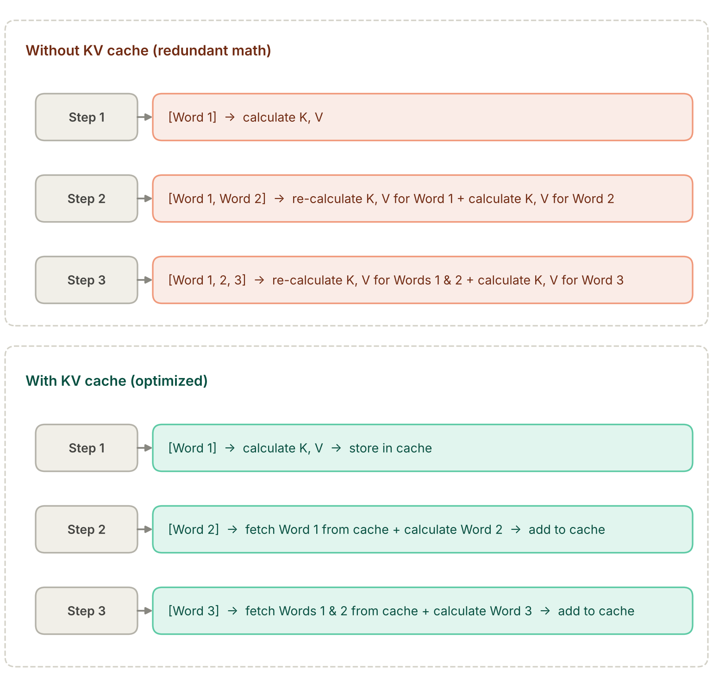
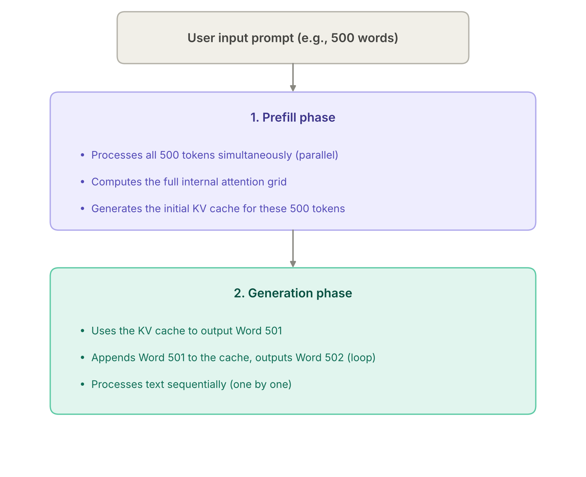
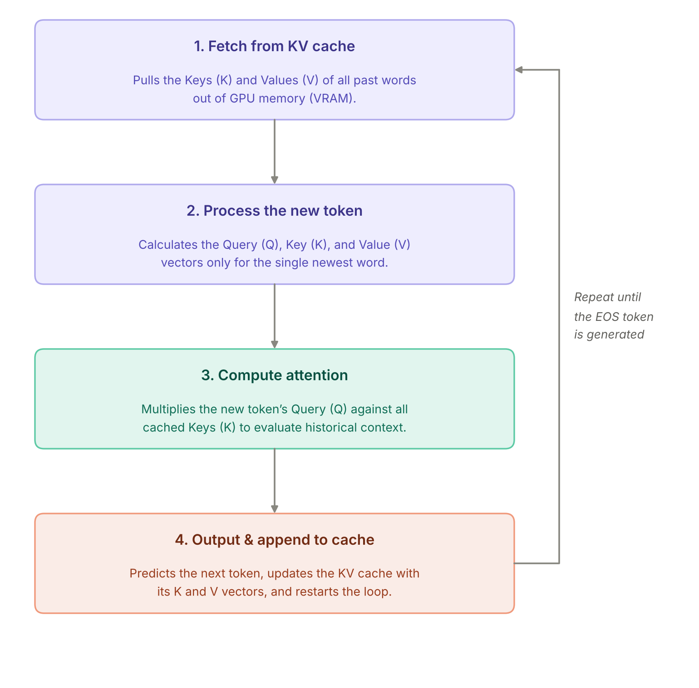
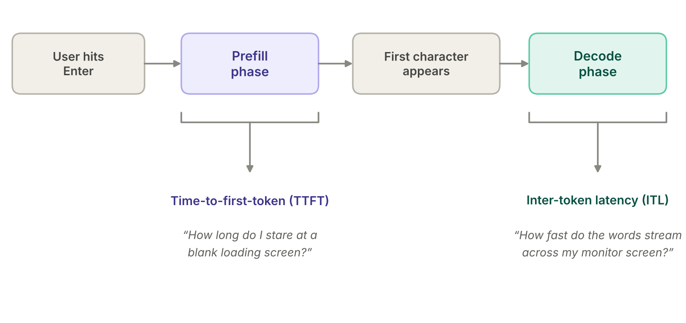

# Chapter 3 - Part 5: KV Cache: prefill phase, decode phase, and why it matters for latency

> Chapter 3: What is an LLM? + Transformers and How They Work

The **KV Cache (Key-Value Cache)** is *a critical optimization technique used in modern LLMs to speed up text generation and reduce massive computing costs*.

Without a KV cache, an AI assistant like ChatGPT or Gemini would slow down drastically with every new word it writes, eventually grinding to a painful halt during long conversations.

To understand why it is necessary, you have to look at the structural tension between how a Transformer is trained versus how it actually generates text.

## The Problem: The Computational Tax of "Auto-Regression"

During text generation, LLMs operate **auto-regressively**. This means they predict the next word, append it to the prompt, and then feed the *entire* text sequence back into the model to predict the word after that.

Imagine you ask an AI to write a story, and it has already generated 99 words. To generate word number 100:

1. The model takes all 99 words as input.
2. It calculates the **Query (Q), Key (K), and Value (V)** matrices for **all 99 words** from scratch.
3. It uses those to calculate the attention map and output word 100.

Now, to generate word number 101, the model has to take all 100 words and **re-calculate Q, K, and V for all 100 words all over again.**

Because the past words never change, calculating their K and V vectors at every single step is entirely redundant. As the conversation grows longer, the GPU spends up to **90% of its time doing duplicate math**, resulting in an algorithmic complexity of O(N²).

## The Solution: What is the KV Cache?

The KV cache is a dedicated slice of high-speed GPU memory (VRAM).

Instead of throwing away the Key and Value vectors after predicting a word, **the model saves (caches) the K and V vectors of all past tokens in memory.**

When it is time to generate the next word, the Transformer executes a highly efficient shortcut:

- **For past tokens:** It completely skips calculating their K and V vectors. It simply pulls them out of the memory cache.
- **For the brand new token:** It calculates its Q, K, and V vectors.
- **The Attention Step:** The new token's single **Query (Q)** vector is matrix-multiplied against the cached **Keys (K)**, and then scaled and multiplied against the cached **Values (V)**.

By caching these tensors, the time complexity to generate a new word drops from **quadratically increasing O(N²) to a flat, constant cost O(1)** per token. This is what keeps your AI chat fluid and fast.

## The New Engineering Bottleneck: VRAM Inflation

While the KV cache completely solves the computing bottleneck, it introduces a severe hardware bottleneck: **it consumes massive amounts of GPU memory.**

As text sequences grow to hundreds of thousands of tokens, the KV Cache expands exponentially. If a model runs out of VRAM to hold the cache, it crashes.

Because of this, modern AI engineering has moved toward specialized architectures explicitly designed to shrink the size of the KV cache:

| Optimization Architecture | How it Shrinks the KV Cache |
| --- | --- |
| Multi-Head Attention (MHA) | The baseline framework. Every single attention head gets its own unique K and V cache. **(Massive memory footprint)** |
| Multi-Query Attention (MQA) | All attention heads share **one single** K and V vector pool. It shrinks the cache footprint by up to 8x but slightly degrades model accuracy. |
| Grouped-Query Attention (GQA) | A middle ground used by models like Meta's **Llama 3**. It groups attention heads into clusters (e.g., 8 heads per group), and each group shares a single K and V cache pool. It offers the speed of MQA with the high reasoning accuracy of MHA. |
| PagedAttention (vLLM) | Manages the KV cache exactly like an operating system manages virtual memory, splitting the cache into dynamic "pages" to eliminate fragmented, wasted GPU memory. |

## Prefill Phase

The **prefill phase** is *the very first step an LLM executes when you submit a prompt, occurring right before the model starts generating text word-by-word*.

While the **generation phase** (also called the decoding phase) processes one brand-new token at a time, the prefill phase **ingests your entire input prompt all at once** to understand the context and populate the **KV Cache**.

Here is the mechanical breakdown of how this phase operates, why it feels different to the user, and how it handles modern computing hardware.

### The Two-Step Lifecycle of a Prompt

When you hit "Send" on a prompt, the LLM’s execution lifecycle is split into two completely distinct phases:

### What Actually Happens During Prefill?

During the prefill phase, the architecture behaves exactly like a classic **Transformer Encoder**, even if the model is a decoder-only architecture like GPT-4 or Llama 3.

1. **Parallel Processing:** The model takes your entire prompt (whether it is 10 words or a 10,000-word document) and feeds it into the GPU simultaneously.
2. **Cross-Token Matrix Multiplication:** The model computes the full Q, K, and V matrices for every single token in the prompt. It multiplies these together to create the **Attention Matrix**—a massive grid mapping how every word in your prompt conceptually connects to every other word.
3. **Priming the KV Cache:** Crucially, the model takes all the computed Key (K) and Value (V) vectors from your prompt and saves them directly into the high-speed GPU memory (VRAM). This "primes" the KV Cache so that when text generation starts, the model never has to recalculate the prompt's context again.
4. **First-Token Prediction:** The final calculation of the prefill phase outputs the very first word of the model's response.

### Prefill Phase vs. Generation Phase

The structural and mechanical profile of the prefill phase is completely opposite to the generation phase:

| Feature | Prefill Phase (Prompt Ingestion) | Generation Phase (Text Output) |
| --- | --- | --- |
| Data Ingest Style | **Parallel** (All prompt tokens processed at once) | **Sequential** (One token at a time) |
| GPU Bottleneck | **Compute-Bound** (The GPU is maxed out doing heavy matrix math calculations) | **Memory-Bandwidth Bound** (The GPU spends time moving data between memory and the processor) |
| Hardware Efficiency | **Extremely High** (Massive matrix math utilizes almost 100% of the GPU's computing cores) | **Low** (The GPU cores spend a lot of time idling, waiting for past data to load from memory) |
| User Experience Impact | **Time-to-First-Token (TTFT):** Dictates how long you stare at a blank screen waiting for the response to start. | **Tokens-per-Second:** Dictates the fluid speed at which the words actually stream onto your screen. |

### The Modern Prefill Challenge: Context Windows

As context windows have expanded to millions of tokens, the prefill phase has become a major engineering bottleneck.

Because the prefill phase calculates how *every* token relates to *every other* token, the math scales **quadratically (O(N²))**. If you upload a massive 500-page PDF, the prefill phase requires a staggering amount of instant compute power and VRAM to map the attention grid all at once. This is why a model might take several seconds before it spits out the very first word of an answer to a massive document, even if the subsequent typing speed is blindingly fast.

To combat this, modern AI engines use techniques like **Chunked Prefill** (splitting a massive prompt into smaller pieces and prefilling them sequentially) to prevent the GPU from running out of memory

## Decode Phase

The **decode phase** (also known as the *generation phase* or *decoding loop*) is the second part of an LLM's execution cycle, where the model actively types out its response one token at a time.

While the *prefill phase* absorbs your entire prompt in one massive parallel crunch to set up the context, the decode phase is a repetitive, step-by-step loop. It takes the token it *just* generated, stores it in memory, and uses it to guess the next word.

### Anatomy of the Decoding Loop

Once the prefill phase outputs the very first word of the response, the model enters the decode phase. For every single subsequent token generated, the model executes this cycle:

This loop breaks continuously until the model hits a special marker called an **EOS (End of Sequence) token**, which tells the engine to stop typing.

### The Core Bottleneck: Memory-Bandwidth Bound

The decode phase is computationally bizarre. If you look at a GPU during this phase, its processing cores (Tensor Cores) are mostly sitting completely idle, yet the hardware is maxed out.

This happens because the decode phase is **Memory-Bandwidth Bound**, whereas the prefill phase is *Compute-Bound*.

- **The Math Deficit:** To predict just *one* word, the GPU processor needs to read the model's trillions of weights and the entire growing KV cache out of its VRAM memory.
- **The Bottleneck:** The speed limit isn't how fast the GPU can do the math—it's how fast the physical wires can transfer gigabytes of data from the memory chips to the processor cores.
- **The Analogy:** Imagine a genius mathematician who can solve equations instantly, but can only read one digit per minute because the book is stored in a room down the hall. The mathematician spends 99% of their time waiting for the page to be delivered.

Because the model has to load all its weights from memory for every single word it generates, **the decode phase is the most expensive and slowest part of running an LLM.**

### Sampling Techniques: How the Decoder Chooses a Word

Once the decode phase completes its attention math, the final *Softmax* layer outputs a list of probability percentages for every word in its vocabulary. The model then uses **sampling algorithms** to decide which word to actually print:

- **Greedy Decoding:** The model simply picks the word with the highest absolute percentage. While efficient, this often results in repetitive, robotic, and boring text loops.
- **Temperature Scaling:** A setting that flattens or sharpens the probability curves. High temperature spreads out the percentages, making the model pick unlikely words (creative/chaotic). Low temperature clusters the odds on the top choices (predictable/factual).
- **Top-P (Nucleus) & Top-K Sampling:** Filters that discard the bottom tier of words. *Top-K* forces the model to look only at the top N words. *Top-P* dynamically looks at the top pool of words whose cumulative probability adds up to a certain threshold (e.g., 90%), cutting off the long tail of nonsensical words.

### How Engineers Speed Up the Decode Phase

Because decoding is so slow and memory-intensive, the AI industry relies on clever architectural workarounds to cheat the hardware limitations:

| Optimization | How it speeds up the Decode Phase |
| --- | --- |
| Speculative Decoding | A tiny, fast draft model guesses 5–6 words ahead very quickly. The massive, slow LLM looks at the chunk and accepts or rejects them all at once, collapsing multiple decode steps into a single check. |
| Quantization | Compresses the model weights from 16-bit floats down to 8-bit or 4-bit integers. This dramatically reduces the amount of data that needs to be transferred across the GPU memory wires, doubling or quadrupling typing speeds. |
| FlashDecoding | A specialized software algorithm that splits up the long KV cache across different sections of the GPU, allowing the attention math of the decode step to be parallelized over hardware cores. |

## Why It Matters for Latency

Understanding the distinction between the **prefill phase** and the **decode phase** is the single most important factor when optimizing **latency** in generative AI.

Because these two phases interact with computer hardware in completely opposite ways, they create two distinct types of delay that dictate the user experience.

### The Two Faces of Latency

When a user interacts with an LLM, latency is broken down into two distinct metric measurements:

### 1. Prefill Phase → Time-to-First-Token (TTFT)

TTFT is the delay between clicking "Send" and seeing the very first character pop up on your screen.

- **Why it matters:** Because prefill is **compute-bound**, the GPU is running at 100% capacity trying to crunch the attention math for your entire prompt at once.
- **The Latency Trigger:** TTFT scales **quadratically (O(N²))** with the size of your input. If you upload a short 10-word prompt, TTFT is virtually instant (milliseconds). If you upload a massive 50,000-word codebase or financial report, the GPU must compute trillions of matrix alignments simultaneously, forcing you to wait several seconds before the model even begins to type.

### 2. Decode Phase → Inter-Token Latency (ITL)

ITL is the speed at which individual words appear once the generation starts (often measured in *Tokens per Second*).

- **Why it matters:** Because decode is **memory-bandwidth bound**, the GPU cores are sitting mostly idle. The latency here is strictly limited by how fast the physical memory wires can stream the model's weights and the growing **KV cache** into the processor for *every single word*.
- **The Latency Trigger:** ITL scales **linearly (O(N))** based on the length of the *output*. The longer the essay you ask the AI to write, the more times it must repeat this slow, memory-throttled loop.

### Hardware Trade-offs: The Latency Balance Beam

Because these phases trigger different bottlenecks, engineers cannot use a single trick to fix all latency issues. They have to optimize for each phase independently:

| To Fix This Latency Metric... | ...You Must Optimize This Component | Engineering Trade-offs & Techniques |
| --- | --- | --- |
| TTFT (Prefill Latency) | **Raw Compute Power (FLOPs)** | Use faster processing cores (like H100/B200 GPUs) or use **Chunked Prefill** to break up long documents so the system doesn't freeze under heavy math. |
| ITL (Generation Latency) | **Memory Bandwidth & Size** | Use **Quantization** (shrinking weights from 16-bit to 4-bit) so less data travels over the wires, or use **GQA (Grouped-Query Attention)** to compress the KV cache size in memory. |

### The Core Takeaway for System Architects

If you are building an AI application, understanding this divide determines how you design your user experience:

- **For Chatbots:** Users hate staring at a frozen screen. Therefore, you prioritize minimizing **TTFT**. You stream tokens immediately as they are decoded rather than waiting for the full response to finish.
- **For Agentic Workflows:** If an AI agent is reading a massive database in the background where a human isn't watching, TTFT doesn't matter. Instead, you optimize for **throughput**—packing as many prompts into the GPU as possible to maximize total tokens generated per second.
