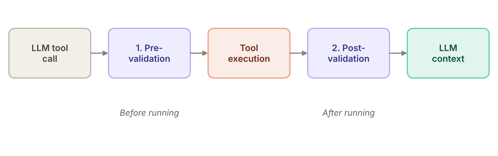

# Chapter 10 - Part 4: Tool Schemas and Validation

> Chapter 10: Tool-Using LLMs: Function Calling and Structured Outputs

**Tool Schemas** are structured JSON definitions (based on the JSON Schema specification) sent inside your API payload that describe what a function does, what inputs it expects, and which fields are mandatory.

Because an LLM cannot read your actual Python or TypeScript source code, the tool schema acts as both the **user manual** (helping the model decide *when* and *how* to call the tool) and the **grammatical contract**

(enforcing valid JSON formatting during token generation).

## Anatomy of a Tool Schema

Here is a standard OpenAI-compatible tool schema for checking an order status:

```text
{
  "type": "function",
  "function": {
    "name": "get_order_status",
    "description": "Retrieves the current shipping status and estimated delivery date for a customer order. Use this whenever a user asks where their package is. Do NOT use this to cancel or modify orders.",
    "strict": true,
    "parameters": {
      "type": "object",
      "properties": {
        "order_id": {
          "type": "string",
          "description": "The unique alphanumeric order identifier, formatted as ORD- followed by 6 digits (e.g., ORD-849201)."
        },
        "include_tracking_history": {
          "type": "boolean",
          "description": "Set to true only if the user explicitly asks for step-by-step transit checkpoints."
        }
      },
      "required": ["order_id", "include_tracking_history"],
      "additionalProperties": false
    }
  }
}
```

**Output**

```text
{'type': 'function',
 'function': {'name': 'get_order_status',
  'description': 'Retrieves the current shipping status and estimated delivery date for a customer order. Use this whenever a user asks where their package is. Do NOT use this to cancel or modify orders.',
  'strict': True,
  'parameters': {'type': 'object',
   'properties': {'order_id': {'type': 'string',
     'description': 'The unique alphanumeric order identifier, formatted as ORD- followed by 6 digits (e.g., ORD-849201).'},
    'include_tracking_history': {'type': 'boolean',
     'description': 'Set to true only if the user explicitly asks for step-by-step transit checkpoints.'}},
   'required': ['order_id', 'include_tracking_history'],
   'additionalProperties': False}}}
```

```text
Key Components Explained
```

- **name:** A clear, action-oriented identifier using snake_case (e.g., search_knowledge_base, create_refund). Avoid vague names like process_data or handle_request.
- **description:** The most critical field for routing accuracy. Treat it like a mini-prompt: state **what** the tool does, **when** to use it, and **when NOT** to use it (especially when multiple tools have overlapping purposes).
- **parameters (properties & type):** Defines each input argument, its JSON data type (string, integer, boolean, array, object), and a field-level description with concrete formatting examples (such as date formats like YYYY-MM-DD).
- **enum (Highly Recommended):** Restricts a string parameter to an exact list of allowed values (e.g., "enum": ["pending", "shipped", "delivered"]), preventing the model from inventing invalid status labels.
- **required:** Lists every parameter the model must supply before calling the function. If a required value is missing from the user's message, a well-aligned model will ask the user a clarifying question instead of guessing.
- **strict: true & additionalProperties: false:** Enables **Constrained Decoding** at the API provider's inference layer, guaranteeing the model cannot invent extra keys or violate data types.

```text
Best Practices for Schema Design
```

- **Keep Tools Atomic (Single Responsibility):** One tool should perform one clear action. Avoid bloated "god functions" with 20 optional parameters, which confuse the model and degrade argument accuracy.
- **Never Expose Security-Sensitive Parameters:** Do not put user_id, role, or is_admin in the tool schema if those values should come from the authenticated session. Inject trusted identity context inside your **Tool Arbiter** on the backend instead.
- **Use Enums Over Free Text:** Whenever an input maps to a fixed set of categories, currencies, or units, define an enum array rather than asking the model to format a free-text string.
- **Cap Your Active Tool Count:** Passing more than 15–20 tool schemas in a single API call consumes massive system prompt tokens and lowers routing accuracy. Dynamically filter and pass only the tools relevant to the current user's workflow.

```text
Writing Tool Schemas
```

Writing effective tool schemas is prompt engineering for APIs. Because the LLM never sees your underlying Python or TypeScript implementation, the schema's names, types, and descriptions are the *only* information the model has to decide when to call a function and how to populate its arguments.

### 1. Core Principles for Writing Tool Schemas

- **Write Descriptions as Decision Boundaries:** Tell the model **what** the tool does, **when** to use it, and **when NOT** to use it (especially if you have similar tools like search_orders vs. get_order_details).
- **Constrain Inputs with enum:** Whenever a parameter accepts a fixed set of choices (e.g., currencies, statuses, sort orders), use "enum": [...]. Never leave fixed categories as open-ended strings.
- **Give Formatting Examples in Parameter Descriptions:** If an API expects a specific format, show an exact example right inside the field description (e.g., "Date in YYYY-MM-DD format, e.g., 2026-11-12").
- **Omit Session & Auth Context:** Never include user_id, tenant_id, or auth_token in the schema if your backend already knows who is logged in. Inject those securely inside your **Tool Arbiter** after the model makes the call.
- **Enable Strict Mode:** Always set "strict": true and "additionalProperties": false so the API provider uses constrained decoding to guarantee valid JSON types and keys.

### 2. Weak Schema vs. Production-Ready Schema

| Aspect | Weak Schema (Prone to Hallucinations) | Production-Ready Schema |
| --- | --- | --- |
| Function Name | update_user | update_user_notification_preferences |
| Description | "Updates user settings." | "Updates email or SMS alert settings for the active user. Use only when the user explicitly asks to change notification preferences. Do NOT use to change passwords or billing info." |
| Channel Parameter | {"type": "string"} | {"type": "string", "enum": ["email", "sms", "push"], "description": "Delivery channel to update."} |
| Identity Field | Includes "user_id": {"type": "string"} (Model might guess or be injected) | Omitted from schema; injected automatically from the authenticated backend session. |

### 3. Auto-Generating Schemas in Python (Pydantic)

In production, you rarely hand-write raw JSON schemas. Instead, you define a **Pydantic** model using Python type hints, Literal enums, and Field descriptions, and let the SDK compile the strict JSON schema automatically:

```text
from typing import Literal
from pydantic import BaseModel, Field

class IssueRefundInput(BaseModel):
    order_id: str = Field(
        description="The unique order ID starting with 'ORD-' followed by 6 digits (e.g., 'ORD-491022')."
    )
    reason: Literal["damaged_item", "wrong_item", "late_delivery", "customer_changed_mind"] = Field(
        description="Primary reason category for the refund."
    )
    amount_inr: float = Field(
        description="Refund amount in Indian Rupees (INR). Must not exceed the original order total."
    )
    notify_customer: bool = Field(
        default=True,
        description="Whether to send an automated confirmation email once processed."
    )

# Convert directly into an OpenAI/compatible strict tool schema
tool_schema = {
    "type": "function",
    "function": {
        "name": "issue_customer_refund",
        "description": "Processes a partial or full monetary refund for a completed order. Only call this after verifying the order ID and confirming the refund amount with the user.",
        "strict": True,
        "parameters": IssueRefundInput.model_json_schema()
    }
}
```

**Output**

```text
NO OUTPUT
```

## Pre- and Post-Validation

In a production tool-calling system, **Pre- and Post-Validation** are the two deterministic checkpoints wrapping tool execution inside your application backend. Because an LLM is probabilistic and vulnerable to prompt injection, you must validate **both** the arguments the model sends *into* a tool (Pre-Validation) and the data the tool sends *back* into the model's context window (Post-Validation).





### 1. Pre-Validation (Before Tool Execution)

Pre-validation inspects and sanitizes the LLM's requested function call **before** it touches your database, file system, or external APIs. Even when strict: true guarantees valid JSON syntax, semantic and security flaws can still slip through.

- **Type & Schema Parsing:** Parse the raw JSON string through a strict runtime validator (such as Pydantic in Python or Zod in TypeScript) to enforce regex patterns, string lengths, and numeric ranges (amount > 0).
- **Authorization & Session Binding:** Verify that the authenticated user actually owns the resource being accessed. Override or cross-check any user_id or account_id against the server's verified session token to prevent IDOR (Insecure Direct Object Reference) attacks.
- **Business Logic & Policy Guardrails:** Enforce domain rules that JSON schemas cannot express—for example, blocking refunds larger than the original order total, restricting SQL tools to SELECT-only queries, or triggering Human-in-the-Loop (HITL) approval for high-risk actions.
- **Self-Healing Error Feedback:** If pre-validation fails, **do not crash the application**. Return a clear, descriptive error string in the role: "tool" message (e.g., "Validation Error: start_date cannot be in the past"), allowing the LLM to fix its arguments and retry on the next turn.

### 2. Post-Validation (After Tool Execution)

Post-validation inspects, filters, and sanitizes the raw output returned by the tool **before** appending it to the messages array for the LLM's next inference step.

- **Indirect Prompt Injection Defense:** External data fetched by tools (such as web pages, emails, support tickets, or database records) may contain hidden malicious instructions. Post-validation strips suspicious control tokens, wraps the output in strict XML data delimiters (e.g., <tool_output>...</tool_output>), or runs a lightweight guardrail classifier over untrusted text.
- **PII & Secret Redaction:** Strip sensitive fields—such as password hashes, internal API keys, Aadhaar/PAN numbers, or unmasked credit card digits—from raw database rows so they never enter the LLM's context window or leak into the final response.
- **Token Budget Truncation:** External APIs or SQL queries can accidentally return thousands of rows, blowing up context limits and causing attention decay. Post-validation caps output length (e.g., truncating to the top 20 records or 4,000 characters) and appends a truncation notice so the model knows more data exists.
- **Empty or Malformed Result Normalization:** If an API returns null, [], or a cryptic HTTP 500 stack trace, post-validation translates it into a clean, unambiguous status message (e.g., "No records found matching order ID ORD-123") so the model does not hallucinate missing details.

## Summary Comparison

| Dimension | Pre-Validation (Input Gate) | Post-Validation (Output Gate) |
| --- | --- | --- |
| Protects | Your backend systems, databases, and external APIs | The LLM's context window and the end user |
| Primary Threats | Hallucinated arguments, SQL/command injection, unauthorized actions | Indirect prompt injection, PII/secret leakage, context window overflow |
| On Failure | Blocks execution and returns a corrective error to the LLM | Redacts, truncates, or sanitizes payload before feeding it to the LLM |
